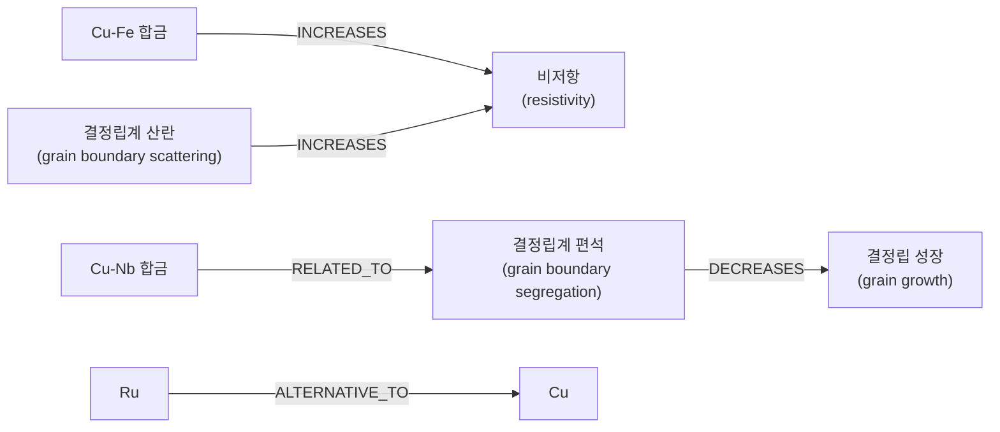
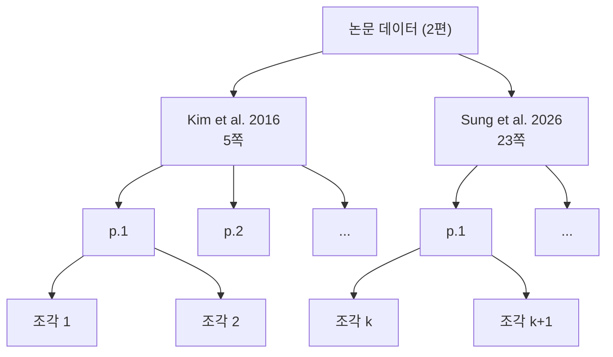

# 01. 자료구조 기초 — 데이터를 "어떤 모양으로" 담을 것인가

> **이 문서를 읽는 시점**: 노트북(`00_...ipynb`)을 열기 **전에** 한 번 훑어 보세요.
> 노트북에서 `[...]`, `{...}`, `np.array(...)`, "노드", "간선", "색인" 같은 말이 나올 때 이 문서로 돌아오면 됩니다.

> **코드를 몰라도 읽을 수 있습니다.** 각 절은 **① 실험실 비유 → ② 그림·표 → ③ (선택) 파이썬 예시** 순서입니다.
> 회색 코드 상자는 "노트북에서 이런 모양으로 보인다"는 것을 미리 보여 주는 용도이므로, 처음 읽을 때는 **건너뛰어도 이해에 지장이 없습니다.**
> 코드 상자 안에서 `#` 뒤의 글은 설명(주석)이고, `# →` 뒤는 실행했을 때 나오는 결과입니다.

## 들어가며

실험실에서 시료를 관리할 때를 떠올려 봅시다.

- 시료 번호표를 **순서대로** 늘어놓기도 하고,
- 물성표에 **항목별로** 값을 적기도 하고,
- 시약장에 **라벨**을 붙여 바로 찾을 수 있게 하기도 합니다.

같은 정보라도 **어떤 모양으로 정리하느냐**에 따라 찾기 쉬움, 고치기 쉬움, 계산하기 쉬움이 달라집니다.
컴퓨터에서 이 "정리하는 모양"을 **자료구조(Data Structure)** 라고 부릅니다.

이 문서에서 다루는 순서는 다음과 같습니다.

| 절 | 자료구조 | 실험실 비유 | 튜토리얼에서 만나는 곳 |
|---|---|---|---|
| 1 | 변수와 자료형 | 시료 한 개에 붙은 라벨 | 모든 노트북 |
| 2 | 리스트(List) | 순서대로 늘어놓은 시료 번호표 | 문서 조각 목록, 검색 결과 |
| 3 | 딕셔너리(Dictionary) | 물성표의 한 줄 | 메타데이터, LLM 출력 |
| 4 | 리스트 안의 딕셔너리 = 표 | 물성표 전체 | CSV, SQL 결과 |
| 5 | JSON | 표준 양식의 실험 기록지 | LLM 구조화 출력, 07에서 추출한 지식그래프 트리플 |
| 6 | 2차원 표 / DataFrame | 엑셀 시트 | 02 RDB |
| 7 | 벡터와 행렬 | XRD 패턴(숫자 배열) | 03 VectorDB, 06 Vector RAG |
| 8 | 그래프(Graph) | 결정 격자, 논문 인용망 | 04 GraphDB, 07 Graph RAG |
| 9 | 트리(Tree) | 폴더 구조, 논문 → 페이지 → 조각 | 문서 분할(Chunking) |
| 10 | 해시와 인덱스 | 책 뒤 색인, 시약장 라벨 | 모든 DB의 "빠른 검색" |

---

## 1. 변수와 자료형 — 값에 이름표 붙이기

**변수(Variable)** 는 값에 붙이는 이름표입니다. 시료 병에 "Cu-1" 라벨을 붙여 두면 나중에 "Cu-1 가져와"라고 부를 수 있는 것과 같습니다.

**자료형(Data Type)** 은 "이 값이 어떤 종류인가"입니다. 실험 노트에도 숫자(측정값), 글(시료 이름), 예/아니오(열처리 여부)가 섞여 있듯이, 컴퓨터도 값의 종류를 구분합니다. 종류에 따라 할 수 있는 일이 다릅니다.

| 자료형 | 파이썬 이름 | 예 | 할 수 있는 일 |
|---|---|---|---|
| 정수 | `int` | `40`, `2016` | 더하기, 비교 |
| 실수 | `float` | `1.68`, `0.5` | 사칙연산 |
| 문자열 | `str` | `"Cu"`, `"grain boundary"` | 이어 붙이기, 단어 찾기 |
| 불리언 | `bool` | `True`, `False` | 조건 판단(if) |
| 없음 | `None` | `None` | "값이 아직 없음" 표시 |

(선택) 파이썬에서는 이렇게 적습니다.

```python
metal = "Cu"            # 문자열(str): 글자. 따옴표로 감쌉니다.
resistivity = 1.68      # 실수(float): 소수점 있는 숫자 (단위: μΩ·cm)
grain_size_nm = 40      # 정수(int): 소수점 없는 숫자
is_annealed = True      # 불리언(bool): 참(True) 또는 거짓(False)

print(metal, resistivity)   # → Cu 1.68
```

> **자주 하는 실수**: `"1.68"`(따옴표 있음)은 문자열이고 `1.68`은 숫자입니다.
> 문자열끼리는 `"1.68" + "1"` → `"1.681"`처럼 **글자가 이어 붙습니다**. CSV에서 읽은 숫자가 계산이 안 될 때 가장 먼저 의심할 부분입니다.

---

## 2. 리스트(List) — 순서가 있는 번호표 줄

**리스트**는 여러 값을 **순서대로** 담은 것입니다. 시료 보관함에 번호 순서대로 꽂아 둔 시료병과 같습니다.

```
 칸 번호(인덱스):  0     1     2     3     4      ← 컴퓨터는 0번부터 셉니다
               ┌─────┬─────┬─────┬─────┬─────┐
 시료 보관함    │ Cu  │ Co  │ Ru  │ Mo  │  W  │
               └─────┴─────┴─────┴─────┴─────┘
 뒤에서부터:     -5    -4    -3    -2    -1
```

(선택) 파이썬에서는 대괄호 `[ ]` 로 적습니다.

```python
metals = ["Cu", "Co", "Ru", "Mo", "W"]   # 대괄호 [ ] 로 만듭니다

print(metals[0])     # → Cu   (첫 번째. 파이썬은 0부터 셉니다!)
print(metals[-1])    # → W    (맨 마지막)
print(metals[1:3])   # → ['Co', 'Ru']  (1번부터 3번 '직전'까지)
print(len(metals))   # → 5    (개수)
```

리스트의 특징은 다음과 같습니다.

- **순서가 있습니다.** 몇 번째 칸인지(인덱스)로 바로 꺼낼 수 있습니다.
- **같은 값이 여러 번 들어가도 됩니다.**
- **"Ru가 어디 있지?"를 찾으려면 앞에서부터 하나씩 봐야 합니다.** (10절에서 다시 다룹니다)

튜토리얼에서는 이런 곳에서 리스트를 만납니다.

```python
docs = load_papers()          # 페이지 28개가 담긴 리스트
chunks = split_documents(docs)  # 조각 183개가 담긴 리스트
print(len(chunks))            # → 183
first = chunks[0]             # 첫 번째 조각
```

`for` 문으로 리스트를 하나씩 훑을 수 있습니다.

```python
for m in metals:              # metals 안의 값을 하나씩 m 에 넣으며 반복
    print(m, "배선 후보")
```

---

## 3. 딕셔너리(Dictionary) — 물성표의 한 줄

**딕셔너리**는 "항목 이름(키, key) → 값(value)" 쌍을 모아 둔 것입니다.
물성표의 **한 줄**을 그대로 옮겨 놓은 모양입니다. "비저항이 얼마지?"라고 물으면 몇 번째 칸인지 셀 필요 없이 "비저항" 칸을 바로 보면 됩니다.

| 키(key) = 항목 이름 | 값(value) |
|---|---|
| `"name"` | `"Cu"` |
| `"resistivity"` | `1.68` (μΩ·cm, 벌크·상온) |
| `"emfp_nm"` | `39.9` (전자 평균자유행로, nm) |
| `"structure"` | `"FCC"` |

(선택) 파이썬에서는 중괄호 `{ }` 로 적습니다.

```python
cu = {
    "name": "Cu",              # 키 "name" → 값 "Cu"
    "resistivity": 1.68,       # 비저항, μΩ·cm (벌크, 상온)
    "emfp_nm": 39.9,           # 전자 평균자유행로(EMFP), nm
    "structure": "FCC",        # 결정 구조
}

print(cu["resistivity"])       # → 1.68  (키로 값을 꺼냅니다)
cu_annealed = {**cu, "annealed": True}   # 원본은 두고, 항목을 추가한 '새' 딕셔너리
```

리스트와의 차이를 표로 비교해 봅시다.

| | 리스트 | 딕셔너리 |
|---|---|---|
| 꺼내는 방법 | 번호(위치) `metals[2]` | 이름(키) `cu["name"]` |
| 비유 | 줄 선 시료병 | 라벨 붙은 서랍 |
| 찾는 속도 | 값으로 찾으면 앞에서부터 훑음 | 키로 찾으면 **바로** 찾음 |
| 튜토리얼 예 | 검색 결과 목록 | 조각의 `metadata` (`{"source": ..., "page": 3}`) |

> 키는 하나의 딕셔너리 안에서 **중복될 수 없습니다.** 같은 키에 다시 값을 넣으면 덮어씁니다.
> 물성표 한 줄에 "비저항" 칸이 두 개일 수 없는 것과 같습니다.

---

## 4. 리스트 안의 딕셔너리 = 표

딕셔너리 하나가 표의 **한 줄**이라면, 딕셔너리 여러 개를 리스트에 담으면 **표 전체**가 됩니다.

```python
metals = [
    {"name": "Cu", "resistivity": 1.68, "emfp_nm": 39.9},
    {"name": "Co", "resistivity": 6.2,  "emfp_nm": 11.8},
    {"name": "Ru", "resistivity": 7.8,  "emfp_nm": 6.59},
    {"name": "Mo", "resistivity": 5.34, "emfp_nm": 11.2},
]

# "EMFP가 15 nm 미만인 금속"을 골라 봅시다
short = [m["name"] for m in metals if m["emfp_nm"] < 15]
print(short)   # → ['Co', 'Ru', 'Mo']
```

이것을 표로 그리면 이렇습니다.

| (리스트 위치) | name | resistivity (μΩ·cm) | emfp_nm |
|---|---|---|---|
| 0 | Cu | 1.68 | 39.9 |
| 1 | Co | 6.2 | 11.8 |
| 2 | Ru | 7.8 | 6.59 |
| 3 | Mo | 5.34 | 11.2 |

> 수치는 리뷰 논문(Sung et al., 2026) Table 1의 대표값입니다(Cu 비저항 1.678은 1.68로 반올림). 노트북 02가 쓰는 `paper_data/metal_properties.csv`에도 같은 값이 들어 있습니다.
> EMFP가 짧을수록 선폭이 수 nm 수준으로 줄어도 **크기 효과(size effect)** 로 인한 저항 증가가 덜합니다. 그래서 벌크 비저항은 Cu보다 높아도 Ru·Co·Mo가 차세대 배선 후보로 거론됩니다.

**이 "딕셔너리의 리스트" 모양은 튜토리얼 전체에서 가장 자주 보게 됩니다.** CSV 파일을 읽은 결과, SQL 질의 결과, LLM이 추출한 지식그래프 트리플이 모두 이 모양입니다.

---

## 5. JSON — 모두가 합의한 기록 양식

**JSON(JavaScript Object Notation)** 은 리스트와 딕셔너리를 **글자(텍스트)로 적는 표준 양식**입니다.
연구실마다 실험 기록지 양식이 다르면 서로 읽기 어렵듯이, 프로그램끼리 데이터를 주고받을 때도 공통 양식이 필요합니다. 그것이 JSON입니다.

```json
{
  "subject": "Cu-Nb",
  "relation": "REDUCES",
  "object": "grain growth",
  "evidence_page": 3
}
```

파이썬 딕셔너리와 거의 똑같이 생겼습니다. 차이점은 몇 가지뿐입니다.

| | 파이썬 | JSON |
|---|---|---|
| 문자열 따옴표 | `'...'` 또는 `"..."` | 반드시 `"..."` |
| 참/거짓 | `True` / `False` | `true` / `false` |
| 없음 | `None` | `null` |
| 정체 | 메모리 속 데이터 | 파일·네트워크로 보내는 **글자** |

```python
import json

text = '{"name": "Ru", "resistivity": 7.1}'   # LLM이 돌려준 '글자'
data = json.loads(text)                        # 글자 → 딕셔너리
print(data["resistivity"])                     # → 7.1

back = json.dumps(data, ensure_ascii=False)    # 딕셔너리 → 글자 (한글 유지)
```

### 왜 RAG에서 JSON이 중요한가

LLM은 원래 **자유로운 문장**을 씁니다. 그런데 프로그램이 LLM의 답을 이어서 쓰려면(예: DB에 넣기, 그래프 만들기) **정해진 칸에 정해진 값**이 있어야 합니다. 그래서 LLM에게 "JSON으로 답해라"라고 요청합니다.

```
 사람이 원하는 것            LLM 출력 (JSON)                      프로그램
 "논문에서 재료와          [{"subject":"Cu-Fe",           →  json.loads()  →  그래프 DB에
  물성 관계를 뽑아 줘"        "relation":"INCREASES",                         노드·간선 추가
                             "object":"resistivity"}]
```

> **소형 모델 주의**: 4B 모델은 가끔 JSON 앞뒤에 설명 문장을 붙이거나, 쉼표를 빼먹어 `json.loads()`가 실패합니다.
> 노트북에서는 이를 대비해 "JSON 부분만 잘라내기 → 실패하면 다시 요청하기" 같은 방어 코드를 씁니다.

---

## 6. 2차원 표와 DataFrame

4절의 "딕셔너리의 리스트"는 훌륭하지만, 정렬·필터·평균 같은 작업을 매번 `for` 문으로 쓰기는 번거롭습니다.
**pandas의 DataFrame**은 엑셀 시트처럼 행(row)과 열(column)이 있는 표를 다루는 도구입니다.

```python
import pandas as pd

df = pd.DataFrame(metals)                     # 4절의 리스트를 그대로 표로
print(df.sort_values("resistivity"))          # 비저항 순 정렬
print(df[df["emfp_nm"] < 15])                 # EMFP < 15 nm 인 행만
print(df["resistivity"].mean())               # 평균 비저항
```

```
         열(column) →  name   resistivity   emfp_nm
 행(row) ↓      0      Cu        1.68         39.9
                1      Co        6.20         11.8
                2      Ru        7.80          6.59
                3      Mo        5.34         11.2
                ↑
             인덱스(행 번호)
```

| 용어 | 의미 | 실험실 비유 |
|---|---|---|
| 행(Row) | 데이터 한 건 | 시료 하나 |
| 열(Column) | 항목 하나 | 측정 항목(비저항, 결정립 크기 등) |
| 셀(Cell) | 행과 열이 만나는 값 하나 | 측정값 하나 |

DataFrame은 **한 파일, 한 사람**이 쓰기에 좋습니다. 여러 표를 연결하고, 여러 사람이 동시에 고치고, 아주 큰 데이터를 빠르게 찾으려면 **관계형 데이터베이스(RDB)** 가 필요합니다. 이것은 [02. 데이터베이스 기초](02_데이터베이스_기초.md)에서 다룹니다.

---

## 7. 벡터와 행렬 — 숫자 배열로 "의미"를 담기

### 7.1 벡터는 "숫자들의 줄"

**벡터(Vector)** 는 숫자를 일정한 개수만큼 늘어놓은 것입니다.
XRD 패턴을 각도별 세기(intensity) 숫자 배열로 저장하는 것과 같습니다. 2θ = 20°, 20.02°, 20.04°, ... 에서 잰 세기를 순서대로 적으면 숫자 수천 개짜리 벡터 하나가 됩니다.

(선택) 파이썬에서는 numpy 라는 도구로 벡터를 만듭니다.

```python
import numpy as np

v = np.array([0.9, 0.1, 0.2])   # 숫자 3개짜리 벡터 = 3차원 벡터
print(v.shape)                   # → (3,)
```

- **차원(Dimension)**: 벡터에 들어 있는 숫자의 개수입니다. 위 예는 3차원입니다.
- 튜토리얼의 임베딩 모델은 문장 하나를 **수백 차원**의 벡터로 바꿉니다. (정확한 차원 수는 노트북에서 `len(vector)`로 직접 확인합니다.)

### 7.2 임베딩: 문장 → 벡터

**임베딩(Embedding)** 은 문장의 "의미"를 벡터로 바꾸는 일입니다. 의미가 비슷한 문장은 **비슷한 방향**의 벡터가 되도록 모델이 학습되어 있습니다.

```
 "구리 배선의 비저항"                 → [0.9, 0.1, 0.2]
 "Cu interconnect resistivity"       → [0.8, 0.2, 0.1]   ← 언어는 달라도 방향이 비슷
 "Ru 박막 증착 공정"                   → [0.6, 0.1, 0.7]
 "결정립계 편석의 열역학"               → [0.2, 0.9, 0.1]
```

> 위 숫자는 설명을 위해 만든 3차원 예시입니다. 실제 임베딩은 수백 차원이고 각 숫자가 무엇을 뜻하는지 사람이 해석할 수 없습니다.

### 7.3 행렬은 "벡터를 여러 줄 쌓은 것"

**행렬(Matrix)** 은 벡터 여러 개를 위아래로 쌓은 2차원 숫자 표입니다. 183개 조각을 각각 임베딩하면 `183 × (차원 수)` 행렬이 됩니다.

```python
M = np.array([
    [0.8, 0.2, 0.1],   # 조각 A
    [0.2, 0.9, 0.1],   # 조각 B
    [0.6, 0.1, 0.7],   # 조각 C
])
print(M.shape)          # → (3, 3)  = (조각 수, 차원 수)
```

| 개념 | 모양(shape) | 예 |
|---|---|---|
| 스칼라 | 숫자 하나 | `1.68` |
| 벡터 | `(d,)` | 문장 하나의 임베딩 |
| 행렬 | `(n, d)` | 조각 n개의 임베딩 모음 |

### 7.4 코사인 유사도 — 두 벡터가 "같은 쪽을 보는가"

두 벡터가 얼마나 비슷한지는 **화살표 사이 각도**로 잽니다. 각도가 작을수록(같은 방향일수록) 비슷합니다.
이 각도의 코사인 값을 **코사인 유사도(Cosine Similarity)** 라고 합니다.

```
          ▲ 축2
          │      B (결정립계 편석)
          │     ↗
          │    /
          │   /         C (Ru 박막 증착)
          │  /      ↗
          │ /   ↗
          │/↗─────────→ A (Cu 배선 비저항)
          └──────────────────────▶ 축1
            q (질문: 구리 배선의 비저항) 은 A와 거의 같은 방향
```

$$
\mathrm{sim}(\mathbf{a}, \mathbf{b}) = \frac{\mathbf{a}\cdot\mathbf{b}}{\lVert\mathbf{a}\rVert\,\lVert\mathbf{b}\rVert}
$$

- 분자 `a·b`(내적): 같은 자리 숫자끼리 곱해서 모두 더한 값
- 분모: 각 벡터의 길이. 길이로 나누어 **방향만** 비교하게 합니다.
- 값의 범위: **1**(완전히 같은 방향) ~ **0**(무관, 직각) ~ **−1**(정반대)

```python
def cosine_similarity(a, b):
    return np.dot(a, b) / (np.linalg.norm(a) * np.linalg.norm(b))

q = np.array([0.9, 0.1, 0.2])                 # 질문 벡터
for name, row in zip(["A", "B", "C"], M):
    print(name, round(cosine_similarity(q, row), 3))
```

| 조각 | 내용(가정) | 코사인 유사도 | 순위 |
|---|---|---|---|
| A | Cu 배선 비저항 | **0.987** | 1 |
| C | Ru 박막 증착 | 0.802 | 2 |
| B | 결정립계 편석 열역학 | 0.337 | 3 |

**벡터 검색(Vector Search)** 은 바로 이것입니다. 질문을 벡터로 바꾸고, 모든 조각 벡터와 코사인 유사도를 계산해서, **가장 높은 k개**를 돌려줍니다. 노트북 03에서 numpy로 직접 구현한 뒤, 같은 일을 Chroma가 해 준다는 것을 확인합니다.

> **XRD 비유**: 미지 시료의 XRD 패턴을 데이터베이스의 표준 패턴들과 하나씩 겹쳐 보고 "가장 잘 맞는 상(phase)"을 고르는 피크 매칭과 같은 발상입니다. 다만 비교하는 것이 회절 패턴이 아니라 **문장의 의미 벡터**입니다.

---

## 8. 그래프(Graph) — 관계 자체를 데이터로

### 8.1 노드와 간선

여기서 말하는 **그래프**는 x–y 그래프(plot)가 아니라 **점과 선의 연결망**입니다.

- **노드(Node, 정점)**: 대상. 예) 재료 `Cu`, 물성 `resistivity`, 논문 `kim2016`
- **간선(Edge, 엣지)**: 대상 사이의 관계. 예) `Cu-Fe` —(INCREASES)→ `resistivity`



### 8.2 결정 격자와 인용망 비유

| 그래프 개념 | 결정 격자 비유 | 논문 인용망 비유 |
|---|---|---|
| 노드 | 원자 | 논문 |
| 간선 | 원자 간 결합(최근접 이웃) | "A가 B를 인용함" |
| 이웃(Neighbor) | 배위 원자 | 직접 인용한 논문 |
| 차수(Degree) | 배위수(FCC는 12) | 인용 수 |
| 경로(Path) | 원자에서 원자로 건너가는 길 | "인용의 인용"을 따라가기 |

### 8.3 방향 그래프와 무방향 그래프

```
 무방향(Undirected)              방향(Directed)
 원자 결합: 서로 대칭              인용: A → B 와 B → A 는 다름

   Cu ──── Cu                    논문 A ──cites──▶ 논문 B
   │        │                    논문 B ──cites──▶ 논문 C
   Cu ──── Cu
```

- **무방향**: "A와 B가 연결되어 있다"만 의미. 결합, 공동 저자 관계.
- **방향**: 화살표에 의미가 있음. 인용, "증가시킨다", "~의 일부이다".
- 튜토리얼의 지식그래프는 **방향 그래프**입니다. (`Chunk —PART_OF→ Paper`)

### 8.4 컴퓨터에 그래프 저장하기: 인접 리스트

그래프를 저장하는 가장 흔한 방법은 **인접 리스트(Adjacency List)** 입니다. "각 노드마다 이웃 목록"을 딕셔너리로 적어 둡니다.

```python
graph = {
    "Cu-Nb":           ["grain boundary"],
    "Cu-Fe":           ["resistivity"],
    "grain boundary":  ["electron"],
    "electron":        ["resistivity"],
    "resistivity":     [],
}

# Cu-Nb에서 출발해 연결을 따라가 봅시다 (2단계 이웃)
for n1 in graph["Cu-Nb"]:
    for n2 in graph[n1]:
        print("Cu-Nb →", n1, "→", n2)   # → Cu-Nb → grain boundary → electron
```

> 3절의 딕셔너리(키 → 값) + 2절의 리스트(이웃 목록)를 조합한 것뿐입니다. 자료구조는 이렇게 **조립**해서 씁니다.

### 8.5 왜 그래프가 RAG에 필요한가

벡터 검색은 "질문과 **비슷한 문장**"을 찾는 데 강합니다. 그러나 다음과 같은 질문에는 약합니다.

> "결정립계 편석과 관련된 재료들은 각각 어떤 물성에 영향을 주나?"

이 답은 한 문단에 모여 있지 않고, 여러 페이지에 흩어진 **관계를 2~3단계 따라가야** 얻을 수 있습니다. 그래프는 이런 **다단계(multi-hop) 연결**을 따라가는 데 강합니다. 노트북 04와 07에서 다룹니다.

---

## 9. 트리(Tree) — 가지를 치는 계층 구조

**트리**는 그래프의 특별한 경우로, **뿌리(root)에서 시작해 가지가 갈라지기만 하고 다시 합쳐지지 않는** 구조입니다.

### 9.1 폴더 구조

```
repo/                          ← 뿌리(root)
├── paper_data/
│   ├── 1-s2.0-S1359646216302512-main.pdf
│   └── Recent progress in alternative metals ... .pdf
├── skku_rag/
│   ├── config.py
│   └── data.py
└── docs/
    └── 01_자료구조_기초.md      ← 잎(leaf): 더 이상 갈라지지 않음
```

### 9.2 문서 → 페이지 → 조각

RAG에서 논문을 다루는 방식도 트리입니다.



| 단계 | 개수 | 만드는 함수 |
|---|---|---|
| 논문 | 2 | (PDF 파일) |
| 페이지 | 28 | `load_papers()` |
| 조각(Chunk) | 183 | `split_documents(docs, chunk_size=1000, chunk_overlap=100)` |

각 조각은 자기가 어느 논문의 몇 쪽에서 왔는지 `metadata`(딕셔너리!)에 기억합니다. 그래서 RAG가 답할 때 **"출처: Sung 2026, p.7"** 처럼 근거를 댈 수 있습니다.

| 용어 | 의미 |
|---|---|
| 뿌리(Root) | 맨 위 하나 |
| 부모/자식(Parent/Child) | 바로 위/아래로 연결된 노드 |
| 잎(Leaf) | 자식이 없는 노드 |
| 깊이(Depth) | 뿌리에서 몇 단계 내려왔는가 |

---

## 10. 해시와 인덱스 — 왜 검색이 빨라지는가

### 10.1 줄 서서 찾기 vs 색인으로 찾기

리뷰 논문(23쪽)에서 "electromigration"이 나오는 쪽을 찾는다고 합시다.

| 방법 | 하는 일 | 걸리는 시간 |
|---|---|---|
| **처음부터 읽기** | 1쪽부터 끝까지 한 줄씩 훑음 | 책이 2배 두꺼우면 **2배** |
| **책 뒤 색인(Index) 보기** | 색인에서 단어를 찾아 쪽 번호로 바로 이동 | 책이 2배 두꺼워도 **거의 그대로** |

컴퓨터도 똑같습니다.

- 리스트에서 값을 찾으려면 앞에서부터 하나씩 비교해야 합니다. 데이터가 n개면 최악의 경우 n번 봅니다.
- 미리 **색인(Index)** 을 만들어 두면 몇 번 만에 바로 찾습니다.

### 10.2 해시(Hash) — 시약장 라벨 규칙

**해시 함수(Hash Function)** 는 이름을 받아서 "몇 번 칸에 넣을지"를 계산하는 규칙입니다.

```
 시약장 규칙(비유): "원소 기호 첫 글자로 칸을 정한다"

   "Cu" ──규칙──▶  C 칸     꺼낼 때도 같은 규칙으로 계산하면
   "Co" ──규칙──▶  C 칸     → 시약장 전체를 뒤질 필요 없이
   "Ru" ──규칙──▶  R 칸        해당 칸만 열어 보면 됩니다
   "Mo" ──규칙──▶  M 칸
```

실제 해시 함수는 이보다 훨씬 고르게 흩어 주는 계산을 씁니다. 파이썬 **딕셔너리가 키로 값을 "바로" 찾는 비밀이 바로 해시**입니다. 그래서 3절에서 "딕셔너리는 키로 찾으면 바로 찾는다"고 했던 것입니다.

```python
# 리스트: 앞에서부터 훑기
names = ["Cu", "Co", "Ru", "Mo", "Al"]
"Al" in names           # 5개를 차례로 비교 → 데이터가 많을수록 느려짐

# 딕셔너리(해시): 칸 번호를 계산해서 바로 이동
props = {"Cu": 1.68, "Co": 6.2, "Ru": 7.8, "Mo": 5.34, "Al": 2.65}
props["Al"]             # 데이터가 백만 개여도 거의 같은 속도
```

### 10.3 Big-O — "데이터가 늘면 얼마나 느려지나"를 대충 말하는 법

컴퓨터 과학에서는 "데이터가 n배 늘면 시간이 어떻게 늘어나는가"를 **Big-O 표기**로 말합니다. 정확한 시간이 아니라 **늘어나는 경향**만 봅니다.

| 표기 | 읽는 법 | 직관 | 예 |
|---|---|---|---|
| O(1) | 상수 시간 | 데이터가 늘어도 시간 그대로 | 딕셔너리에서 키로 찾기, 시약장 라벨 |
| O(log n) | 로그 시간 | 데이터가 2배가 돼도 한 단계만 더 | 사전 찾기(가운데 펴고 앞/뒤 고르기), DB의 B-tree 인덱스 |
| O(n) | 선형 시간 | 데이터가 2배면 시간도 2배 | 리스트 처음부터 훑기, 줄 서서 찾기 |
| O(n²) | 제곱 시간 | 데이터가 2배면 시간은 4배 | 모든 쌍 비교하기 |

```
 시간
  ▲                                   O(n²)
  │                               .·'
  │                           .·'
  │                       .·'          O(n)
  │                  .·'      ___.---'''
  │             .·'  ___.---''
  │        .·'__.--''                  O(log n)
  │   .·'_.-'  ___________-----------------
  │.·'.-'-'''                           O(1)
  │=======================================
  └─────────────────────────────────────────▶ 데이터 개수 n
```

### 10.4 각 DB가 쓰는 "색인"

모든 데이터베이스의 핵심은 **목적에 맞는 색인을 미리 만들어 두는 것**입니다.

| 데이터베이스 | 색인 종류 | 빠르게 해 주는 질문 |
|---|---|---|
| 관계형 DB (02) | B-tree 인덱스, 해시 인덱스 | "name이 'Ru'인 행" |
| 벡터 DB (03) | 근사 최근접 이웃(ANN) 인덱스 (예: HNSW) | "이 질문 벡터와 가장 가까운 조각 5개" |
| 그래프 DB (04) | 노드별 이웃 목록(인접 리스트) | "Cu-Nb와 연결된 노드들" |

> 벡터 검색은 7절처럼 **모든** 조각과 비교하면 O(n)입니다. 183개는 순식간이지만 수천만 개라면 느립니다. 그래서 벡터 DB는 "정확히 최고 k개" 대신 "**거의** 최고인 k개"를 아주 빨리 찾는 **근사(Approximate)** 색인을 씁니다. 자세한 내용은 [02. 데이터베이스 기초](02_데이터베이스_기초.md)에서 다룹니다.

---

## 핵심 요약

1. **리스트는 순서, 딕셔너리는 이름(키)** 으로 꺼냅니다. "딕셔너리의 리스트"가 곧 표이고, JSON은 이것을 글자로 적은 표준 양식입니다.
2. **벡터**는 의미를 담은 숫자 배열이고, **코사인 유사도**로 "같은 방향인가"를 재는 것이 벡터 검색의 전부입니다. **그래프**는 관계를 노드·간선으로 저장해 여러 단계 연결을 따라가게 해 줍니다.
3. **색인(인덱스·해시)** 을 미리 만들어 두면 "처음부터 훑기(O(n))" 대신 "바로 찾기(O(1), O(log n))"가 가능해집니다. 모든 DB의 속도 비밀이 여기에 있습니다.

## 스스로 확인해 보기

**Q1.** `metals = ["Cu", "Co", "Ru"]` 일 때 `metals[1]` 은 무엇일까요? 그리고 `{"Cu": 1.68}["Cu"]` 는요?

<details>
<summary>정답 보기</summary>

`metals[1]` 은 `"Co"` 입니다. 파이썬은 0부터 세므로 1번은 두 번째 값입니다.
`{"Cu": 1.68}["Cu"]` 는 `1.68` 입니다. 딕셔너리는 위치가 아니라 키로 값을 꺼냅니다.

</details>

**Q2.** 질문 벡터 `q`와 조각 벡터 `A`의 코사인 유사도가 0.99, `B`와는 0.30입니다. 벡터 검색에서 어느 조각이 먼저 나오고, 그 이유는 무엇일까요?

<details>
<summary>정답 보기</summary>

`A`가 먼저 나옵니다. 코사인 유사도가 1에 가까울수록 두 벡터가 같은 방향, 즉 의미가 비슷하다는 뜻이기 때문입니다. 벡터 검색은 유사도가 높은 순서대로 상위 k개를 돌려줍니다.

</details>

**Q3.** "논문 A가 인용한 논문들이 다시 인용한 논문들"을 찾고 싶습니다. 표(DataFrame)와 그래프 중 어느 쪽이 더 자연스러운 자료구조일까요?

<details>
<summary>정답 보기</summary>

그래프가 더 자연스럽습니다. "인용"은 방향이 있는 관계(간선)이고, 질문은 그 관계를 두 단계 따라가는 것(2-hop)이기 때문입니다. 표로도 할 수는 있지만 같은 표를 여러 번 이어 붙여야(JOIN) 하므로 단계가 늘수록 복잡해집니다.

</details>

---

다음 읽기: [02. 데이터베이스 기초](02_데이터베이스_기초.md) · [읽기 자료 목차](README.md)
