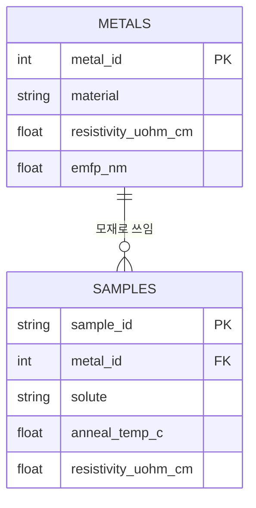
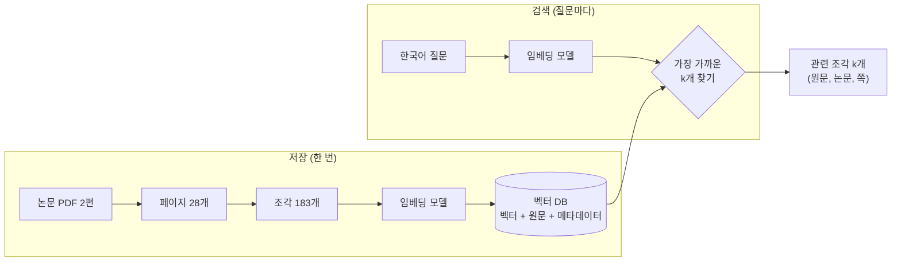
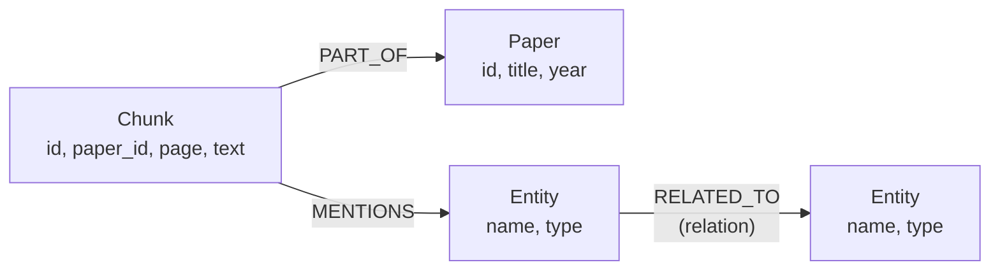
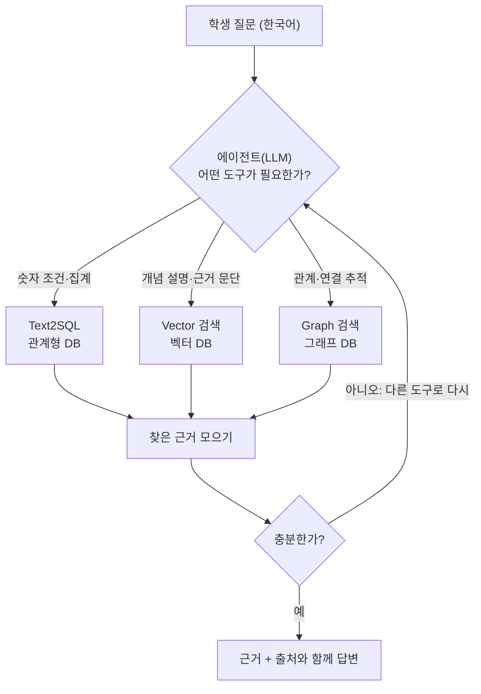

# 02. 데이터베이스 기초 — 관계형 DB · NoSQL · 벡터 DB · 그래프 DB

> **이 문서를 읽는 시점**: [01. 자료구조 기초](01_자료구조_기초.md)를 읽은 뒤, 노트북 `02`(RDB)를 열기 전에 읽으면 좋습니다.
> 벡터 DB 절은 노트북 `03` 전에, 그래프 DB 절은 노트북 `04` 전에 다시 펼쳐 보세요.
>
> **코드를 몰라도 읽을 수 있습니다.** SQL·Cypher 예시는 "이런 모양이구나" 정도로 보고 넘어가도 됩니다. 각 예시 아래에 우리말 풀이를 달아 두었습니다.

## 이 문서의 지도

```
 1. 왜 데이터베이스가 필요한가      (엑셀·폴더 정리의 한계)
 2. DBMS 란                        (데이터를 맡아 주는 관리인)
 3. 관계형 데이터베이스 (RDB)       ── 노트북 02
 4. NoSQL                          ── 전용 노트북 없음 (JSON 문서는 여러 노트북에서 만남)
 5. 벡터 데이터베이스 (Vector DB)   ── 노트북 03, 06
 6. 그래프 데이터베이스 (Graph DB)  ── 노트북 04, 07
 7. 네 가지 비교                    (언제 무엇을 쓰나)
 8. RAG에서 DB들이 쓰이는 방식      ── 노트북 06, 07, 08
 9. 용어집
```

---

## 1. 왜 데이터베이스가 필요한가

연구실 데이터는 보통 이렇게 쌓입니다.

```
 공유 드라이브/
 ├── 시료목록_최종.xlsx
 ├── 시료목록_최종_수정.xlsx
 ├── 시료목록_최종_진짜최종_김OO.xlsx
 ├── 4PP_측정/
 │   ├── 2026-03-02_CuNb_1.csv
 │   └── ...
 └── XRD/ ...
```

처음에는 이 방식으로 충분합니다. 그런데 사람이 늘고 데이터가 쌓이면 다음 문제가 생깁니다.

| 문제 | 실험실에서 생기는 일 | 데이터베이스가 해 주는 일 |
|---|---|---|
| **동시 사용** | 두 사람이 같은 엑셀을 열어 고치면 한쪽 수정이 사라짐 | 여러 사람이 동시에 읽고 써도 충돌을 정리해 줌 |
| **검색** | "Nb 1% 이상, 400 °C 열처리, 비저항 3 μΩ·cm 미만 시료"를 찾으려면 파일을 다 열어 봄 | 조건을 적으면 즉시 찾아 줌 (색인 사용) |
| **일관성** | 같은 시료가 파일마다 `CuNb-1`, `Cu-Nb_01`로 다르게 적힘 / 비저항 칸에 "측정예정" 같은 글자가 들어감 | 규칙(형식·필수 여부·중복 금지)을 강제함 |
| **중복** | 금속의 벌크 비저항을 시료마다 반복해 적음 → 하나만 고치면 불일치 | 한 곳에만 저장하고 연결해서 씀 |
| **안전성** | 저장 중 컴퓨터가 꺼지면 파일이 깨짐 | 작업 단위로 "전부 저장 또는 전부 취소" |
| **규모** | 수백만 줄이 넘으면 엑셀이 열리지 않음 | 수십억 건도 다룸 |

> 한 줄 정리: **엑셀은 "한 사람이 보는 표", 데이터베이스는 "여러 사람과 프로그램이 함께 쓰는 공용 저장소"** 입니다.

---

## 2. DBMS — 데이터를 맡아 주는 관리인

**데이터베이스(Database, DB)** 는 정리된 데이터 묶음 자체이고,
**DBMS(Database Management System)** 는 그 데이터를 저장·검색·보호해 주는 **프로그램**입니다.

> **비유: 시약 창고와 창고 관리인.**
> 시약(데이터)이 창고(DB)에 있고, 연구원은 창고 안에 직접 들어가지 않습니다. 관리인(DBMS)에게 "Ru 타깃 하나 주세요"라고 **정해진 양식(질의 언어)** 으로 요청하면, 관리인이 위치를 찾고, 재고를 기록하고, 동시에 온 요청을 순서대로 처리합니다.

```
  사용자/프로그램 ──질의(SQL, Cypher, ...)──▶  DBMS  ──▶  저장된 데이터(디스크)
        ▲                                     │
        └────────────── 결과 ──────────────────┘
```

| DBMS 종류 | 예 | 이 튜토리얼에서 |
|---|---|---|
| 관계형 | SQLite, PostgreSQL, MySQL, Oracle | **SQLite** (노트북 02) |
| 문서형(NoSQL) | MongoDB, Couchbase | 사용 안 함 (개념만) |
| 키-값(NoSQL) | Redis, DynamoDB | 사용 안 함 (개념만) |
| 와이드 컬럼(NoSQL) | Cassandra, HBase | 사용 안 함 (개념만) |
| 벡터 | Chroma, Milvus, Qdrant, (라이브러리) FAISS | **Chroma** (노트북 03, 06) |
| 그래프 | Neo4j, Kùzu, Memgraph | **Kùzu** (노트북 04, 07) |

> SQLite와 Kùzu, Chroma는 모두 **별도 서버 설치 없이 파이썬 안에서 파일 하나(또는 폴더 하나)로 동작**하는 "내장형(embedded)" DB입니다. 그래서 Colab에서도 바로 쓸 수 있습니다.

---

## 3. 관계형 데이터베이스 (RDB)

### 3.1 테이블 · 행 · 열

**관계형 데이터베이스(Relational Database, RDB)** 는 데이터를 **표(테이블, Table)** 여러 개에 나누어 담고, 표끼리 **공통 열로 연결**하는 방식입니다. 1970년 E. F. Codd가 제안한 이래 지금도 가장 널리 쓰입니다.

`metals` 테이블 (금속의 기본 물성, 리뷰 논문 Table 1에서 발췌):

| metal_id (PK) | material | resistivity_uohm_cm | emfp_nm | crystal_structure |
|---|---|---|---|---|
| 1 | Cu | 1.678 | 39.9 | fcc |
| 2 | Co | 6.2 | 11.8 | hcp |
| 3 | Ru | 7.8 | 6.59 | hcp |
| 4 | Mo | 5.34 | 11.2 | bcc |

| 용어 | 다른 이름 | 의미 | 위 표에서 |
|---|---|---|---|
| 테이블(Table) | 릴레이션 | 같은 종류의 데이터를 모은 표 | `metals` |
| 행(Row) | 레코드, 튜플 | 데이터 한 건 | Ru 한 줄 |
| 열(Column) | 속성, 필드 | 항목 하나. **자료형이 정해져 있음** | `emfp_nm` (실수) |
| 스키마(Schema) | — | 테이블 이름·열 이름·자료형·규칙의 설계도 | "emfp_nm은 실수, 비워둘 수 없음" |

> 노트북 02의 실제 `metals` 테이블(`paper_data/metal_properties.csv`)은 이보다 행과 열이 많습니다(Al, Rh, Ir, Ni, Os, Nb 등의 원소와 ρ·λ 곱 같은 항목). 여기서는 일부만 보여 줍니다. 정확한 구조는 노트북의 `SQL_SCHEMA_DESCRIPTION` 출력을 기준으로 보세요.

### 3.2 기본키와 외래키 — 시료 번호와 "참조" 칸

**기본키(Primary Key, PK)**: 각 행을 **유일하게** 구별하는 열입니다. 시료마다 붙이는 **고유 시료 번호**와 같습니다. 같은 번호가 두 번 나올 수 없고, 비워 둘 수도 없습니다.

**외래키(Foreign Key, FK)**: 다른 테이블의 기본키를 가리키는 열입니다. 시료 카드에 "모재: 재료번호 1번"이라고 **참조 번호**를 적어 두는 것과 같습니다.

`samples` 테이블 (실제로 만든 시료들, Kim et al. 2016 실험을 단순화한 예):

| sample_id (PK) | metal_id (FK → metals) | solute | solute_at_pct | anneal_temp_c | grain_size_nm | resistivity_uohm_cm |
|---|---|---|---|---|---|---|
| S-001 | 1 | Nb | 1.0 | 400 | 40 | 3.1 |
| S-002 | 1 | Fe | 1.0 | 400 | 35 | 4.0 |
| S-003 | 1 | Nb | 1.0 | 600 | 70 | 2.6 |

> 이 `samples` 표와 값은 **구조 설명용 가상 예시**입니다. 노트북 02의 실제 `alloy_films` 테이블에는 Kim et al. 2016 Table 1의 조성(at.%)·막 두께·결정립 크기 실측값이 들어 있습니다.



`||--o{` 표시는 "재료 **하나**에 시료가 **여러 개**(0개 이상) 연결될 수 있다"는 뜻입니다(일대다, 1:N 관계).

외래키가 있으면 DBMS가 **"없는 재료를 가리키는 시료"를 넣지 못하게 막아 줍니다.** 이것을 **참조 무결성(Referential Integrity)** 이라고 합니다.

### 3.3 정규화 — "같은 사실은 한 곳에만"

정규화를 하지 않은 표를 봅시다.

| sample_id | material_name | bulk_resistivity | emfp_nm | anneal_temp_c |
|---|---|---|---|---|
| S-001 | Cu | 1.68 | 39.0 | 400 |
| S-002 | Cu | 1.68 | 39.0 | 400 |
| S-003 | Cu | 1.68 | 39.0 | 600 |
| ... (시료 1,000개) | Cu | 1.68 | 39.0 | ... |

Cu의 EMFP 값을 더 정확한 문헌값으로 바꾸려면 1,000줄을 모두 고쳐야 합니다. 하나라도 빠뜨리면 **같은 Cu인데 EMFP가 두 가지**인 모순이 생깁니다.

**정규화(Normalization)** 는 이런 중복을 없애도록 테이블을 쪼개는 설계 원칙입니다.
3.2절처럼 "금속 고유 물성"은 `metals`에, "시료별 조건·측정값"은 `samples`에 두고 **외래키로 연결**하면, Cu의 EMFP는 단 한 곳만 고치면 됩니다.

> **실험실 비유**: 시약의 MSDS 정보를 시료 카드마다 베껴 적지 않고, MSDS 철을 따로 두고 "시약 번호"만 적는 것과 같습니다.

정규화의 대가는 **질문할 때 표를 다시 합쳐야(JOIN) 한다**는 점입니다. 실무에서는 너무 잘게 쪼개지 않도록 적당히 타협합니다.

### 3.4 SQL — 관계형 DB에 묻는 언어

**SQL(Structured Query Language)** 은 관계형 DB에 질문하는 표준 언어입니다. 영어 문장에 가깝게 생겼습니다.

**① SELECT / WHERE — 조건에 맞는 행 고르기**

```sql
SELECT material, resistivity_uohm_cm, emfp_nm    -- 보여 줄 열
FROM metals                                      -- 어느 표에서
WHERE emfp_nm < 15                               -- 어떤 조건으로
ORDER BY resistivity_uohm_cm;                    -- 무엇 순서로
```

> 풀이: "금속 표에서 EMFP가 15 nm 미만인 금속의 이름·비저항·EMFP를 비저항 낮은 순으로 보여 줘."
> 결과(위 4행 기준): Mo(5.34, 11.2), Co(6.2, 11.8), Ru(7.8, 6.59)

**② JOIN — 두 표를 이어 붙이기**

```sql
SELECT s.sample_id, m.material, s.solute, s.resistivity_uohm_cm
FROM samples AS s
JOIN metals AS m ON s.metal_id = m.metal_id         -- 참조 번호가 같은 행끼리 연결
WHERE s.anneal_temp_c = 400;
```

> 풀이: "400 °C에서 열처리한 시료마다, 모재 금속 이름을 금속 표에서 찾아 붙여서 보여 줘."

```
 samples                          metals
 ┌───────┬────────────┐        ┌────────────┬──────┐
 │ S-001 │ metal_id=1 │──┐     │ metal_id=1 │ Cu   │
 │ S-002 │ metal_id=1 │──┴────▶│ metal_id=2 │ Co   │
 └───────┴────────────┘        └────────────┴──────┘
          같은 번호(1)끼리 짝지음 → S-001, S-002 모두 Cu
```

**③ GROUP BY — 묶어서 통계 내기**

```sql
SELECT solute, COUNT(*) AS n, AVG(resistivity_uohm_cm) AS avg_rho
FROM samples
GROUP BY solute;
```

> 풀이: "첨가 원소(Nb, Fe)별로 시료 개수와 평균 비저항을 구해 줘."

| SQL 키워드 | 하는 일 | 엑셀로 치면 |
|---|---|---|
| `SELECT` | 보여 줄 열 고르기 | 열 숨기기/보이기 |
| `FROM` | 대상 테이블 | 어느 시트 |
| `WHERE` | 행 조건 걸기 | 필터 |
| `ORDER BY` | 정렬 | 정렬 |
| `JOIN ... ON` | 표 연결 | VLOOKUP |
| `GROUP BY` | 묶어서 집계 | 피벗 테이블 |

> **Text2SQL**: 노트북 02와 08에서는 LLM에게 테이블 설명(스키마)을 주고 "한국어 질문 → SQL"을 쓰게 합니다. 사람이 SQL을 몰라도 표에 질문할 수 있게 해 주는 방법입니다. 단, 소형 모델은 없는 열 이름을 지어내기도 하므로 실행 전 검증이 필요합니다.

### 3.5 트랜잭션과 ACID — 실험 기록의 원칙

**트랜잭션(Transaction)** 은 "반드시 한 덩어리로 처리되어야 하는 작업 묶음"입니다.

> 예: 새 시료 S-004를 만들면서 **① 시료 표에 한 줄 추가 + ② 스퍼터 타깃 재고 1개 차감**. 둘 중 하나만 반영되면 장부가 틀어집니다.

관계형 DB는 트랜잭션에 대해 다음 네 가지를 보장합니다. 앞 글자를 따서 **ACID**라고 합니다.

| 성질 | 뜻 | 실험 기록 비유 |
|---|---|---|
| **A**tomicity (원자성) | 전부 반영되거나, 전부 취소됨 | 시료 등록과 재고 차감을 같이 하거나 아예 안 함 |
| **C**onsistency (일관성) | 규칙을 어기는 상태로는 끝나지 않음 | "비저항은 음수 불가", "없는 재료 번호 금지"가 항상 지켜짐 |
| **I**solation (격리성) | 동시에 일해도 서로 섞이지 않음 | 두 사람이 같은 타깃 재고를 동시에 차감해도 숫자가 꼬이지 않음 |
| **D**urability (지속성) | 한 번 확정되면 정전에도 남음 | 실험 노트에 볼펜으로 쓰고 서명한 기록 |

### 3.6 관계형 DB 정리

| 잘하는 것 | 약한 것 |
|---|---|
| 정확한 조건 검색(같다, 크다, 작다) | "의미가 비슷한 문장 찾기" |
| 집계·통계(개수, 평균, 최댓값) | 미리 정하지 않은 항목이 계속 생기는 데이터 |
| 일관성·무결성 보장 | 여러 단계 관계 따라가기(JOIN이 계속 늘어남) |
| 수십 년 검증된 안정성, 표준 SQL | 서버 여러 대로 수평 확장하기가 상대적으로 어려움 |

---

## 4. NoSQL — "표가 아닌" 데이터베이스들

### 4.1 NoSQL은 왜 생겼나

**NoSQL**은 "No SQL(SQL 없음)"이 아니라 보통 **"Not only SQL(SQL만이 답은 아니다)"** 로 풀이합니다. 관계형 표 모양이 아닌 방식으로 데이터를 저장하는 DB들을 **묶어 부르는 이름**입니다. 하나의 제품이 아닙니다.

2000년대 후반 검색 엔진·SNS·쇼핑몰이 폭발적으로 커지면서 관계형 DB만으로는 버거운 세 가지 상황이 생겼습니다.

**① 스키마 유연성 — 실험마다 측정 항목이 다르다**

관계형 DB는 표의 열을 **미리** 정해야 합니다. 그런데 연구 데이터는 이렇습니다.

- 시료 A: 4-point probe 비저항만 측정
- 시료 B: 비저항 + XRD + TEM 결정립 크기
- 시료 C: 비저항 + APT(원자탐침) 편석 농도 + 온도별 비저항 곡선(값 20개)

모두 하나의 표에 담으려면 열이 수십 개가 되고 대부분 비어 있게 됩니다. 새 장비가 들어올 때마다 표 설계를 바꿔야 합니다.
NoSQL 문서형 DB는 **"각 기록이 자기 모양을 가져도 된다"** 고 허용합니다.

**② 대용량 — 데이터가 한 컴퓨터에 안 들어간다**

장비 센서가 1초마다 값을 남기면 하루에 수백만 줄이 쌓입니다. 한 대의 컴퓨터를 아무리 키워도(성능 좋은 컴퓨터로 교체 = **수직 확장**) 한계가 옵니다.

**③ 분산 — 여러 대의 컴퓨터에 나누어 담는다**

그래서 **컴퓨터 여러 대에 데이터를 나누어 담는 방식(수평 확장, Scale-out)** 이 필요해졌습니다.

```
 수직 확장 (Scale-up)              수평 확장 (Scale-out)
 더 큰 냉장고 하나로 교체           같은 냉장고를 여러 대 놓고 나눠 보관

   ┌────────────┐                  ┌────┐ ┌────┐ ┌────┐ ┌────┐
   │            │                  │ A~F│ │G~L │ │M~R │ │S~Z │
   │  초대형     │                  └────┘ └────┘ └────┘ └────┘
   │  한 대      │                  시료 이름 첫 글자로 어느 냉장고에 둘지 정함
   └────────────┘                  (01 문서의 '해시' 규칙과 같은 발상)
 한계: 가격·물리적 크기              장점: 필요하면 한 대 더 추가
```

여러 대로 나누면 새로운 고민이 생깁니다. **냉장고 사이에 기록을 맞추는 데 시간이 걸린다**는 것입니다. 이 부분은 4.4절의 비교표에서 다룹니다.

### 4.2 NoSQL의 네 가지 대표 계열

| 계열 | 데이터 모양 | 비유 | 대표 제품 | 연구실 예 |
|---|---|---|---|---|
| **문서형** | JSON 문서 | 시료마다 한 장씩, 양식이 조금씩 다른 실험 기록지 | MongoDB | 시료·실험 기록 |
| **키-값** | 이름표 → 값 | 번호 붙은 사물함 | Redis | 계산 결과 임시 보관(캐시) |
| **와이드 컬럼** | 행마다 열이 매우 많고 유동적인 거대한 표 | 장비별로 시간순으로 넘기는 로그북 | Cassandra | 장비 센서 시계열 |
| **그래프형** | 노드·간선 | 인용망, 결정 격자 | Neo4j | 재료–물성–현상 관계 (6절) |

#### (1) 문서형 DB — 시료마다 한 장의 기록지

**문서형 DB(Document DB)** 는 데이터 한 건을 **JSON 문서 한 개**로 저장합니다([01 문서 5절](01_자료구조_기초.md#5-json--모두가-합의한-기록-양식)). 문서들을 모은 묶음을 **컬렉션(Collection)** 이라고 합니다(관계형의 "테이블"에 해당).

```json
{
  "sample_id": "S-001",
  "base": "Cu",
  "composition": {"Cu": 99.0, "Nb": 1.0},
  "process": {"method": "sputtering", "anneal_temp_c": 400, "anneal_time_h": 1},
  "measurements": {
    "resistivity_uohm_cm": 3.1,
    "grain_size_nm": 40,
    "xrd_peaks_2theta": [43.3, 50.4, 74.1]
  },
  "source": {"paper": "kim2016", "page": 3}
}
```

```json
{
  "sample_id": "S-002",
  "base": "Cu",
  "composition": {"Cu": 99.0, "Fe": 1.0},
  "measurements": {
    "resistivity_uohm_cm": 4.0,
    "apt_gb_excess": 1.8,
    "rho_vs_T": [[300, 4.0], [200, 3.4], [100, 2.9]]
  },
  "note": "TEM 미측정"
}
```

> 측정값은 구조 설명용 가상값이고, XRD 피크 위치는 FCC Cu (111)/(200)/(220)의 대략적인 Cu Kα 2θ 값입니다.

두 문서는 **들어 있는 항목이 서로 다릅니다.** S-001에는 XRD가, S-002에는 APT와 온도별 비저항이 있습니다. 문서형 DB는 이것을 그대로 받아들입니다. 또 `composition`, `process`처럼 **문서 안에 문서를 품을 수(중첩)** 있어, 사람이 보는 실험 기록지와 모양이 비슷합니다.

(선택) MongoDB에서 "Nb가 들어 있고 비저항이 3.5 미만인 시료"를 찾는 질의는 이런 모양입니다.

```javascript
db.samples.find({
  "composition.Nb": { $exists: true },
  "measurements.resistivity_uohm_cm": { $lt: 3.5 }
})
```

#### 같은 데이터를 관계형 표로 담으면?

위 두 문서를 관계형 DB에 넣으려면 대략 이렇게 나누어야 합니다.

```
 samples                     compositions                  measurements
 ┌────────┬──────┬──────┐   ┌────────┬─────────┬──────┐   ┌────────┬──────────────────────┬───────┐
 │sample_id│ base │ note │   │sample_id│ element │ at_pct│   │sample_id│ quantity             │ value │
 ├────────┼──────┼──────┤   ├────────┼─────────┼──────┤   ├────────┼──────────────────────┼───────┤
 │ S-001  │ Cu   │      │   │ S-001  │ Cu      │ 99.0 │   │ S-001  │ resistivity_uohm_cm  │ 3.1   │
 │ S-002  │ Cu   │ TEM..│   │ S-001  │ Nb      │  1.0 │   │ S-001  │ grain_size_nm        │ 40    │
 └────────┴──────┴──────┘   │ S-002  │ Cu      │ 99.0 │   │ S-002  │ resistivity_uohm_cm  │ 4.0   │
                            │ S-002  │ Fe      │  1.0 │   │ S-002  │ apt_gb_excess        │ 1.8   │
 + processes 표              └────────┴─────────┴──────┘   └────────┴──────────────────────┴───────┘
 + xrd_peaks 표 (피크 하나당 한 줄)
 + rho_vs_T 표 (온도 하나당 한 줄)
```

| | 문서형 (MongoDB) | 관계형 (SQLite 등) |
|---|---|---|
| 시료 하나 보기 | 문서 1개를 꺼내면 끝 | 표 5~6개를 JOIN |
| 새 측정 항목 추가 | 그냥 새 키를 적으면 됨 | 표 설계 변경 또는 위처럼 "항목/값" 표로 우회 |
| "모든 시료의 평균 비저항" | 가능하지만 문서마다 항목이 다를 수 있어 주의 | `AVG()` 한 줄, 형식이 보장됨 |
| 오타·형식 오류 방지 | 느슨함 (`resistivity`와 `resistivty`가 둘 다 들어갈 수 있음) | 엄격함 (열 이름·자료형이 고정) |

> **이 튜토리얼과의 연결**: 노트북에서 직접 MongoDB를 쓰지는 않지만, LLM이 논문에서 뽑은 지식그래프 트리플을 저장한 `db/kg_triples.json`(07 노트북에서 여러분이 직접 만드는 파일), 각 조각의 `metadata`가 모두 "문서" 모양의 데이터입니다.

#### (2) 키-값 DB — 번호 붙은 사물함

**키-값 DB(Key-Value Store)** 는 가장 단순한 형태입니다. **키(이름표)** 하나에 **값(무엇이든)** 하나를 넣고, 키로만 꺼냅니다. 01 문서의 딕셔너리를 거대하게 키운 것과 같습니다.

```
 키 (사물함 번호)                          값 (안에 든 물건)
 ─────────────────────────────────────────────────────────────
 "embed:구리 배선의 비저항"           →    [0.12, -0.03, ...]   (계산해 둔 임베딩)
 "answer:Ru의 EMFP는?"                →    "약 6.6 nm ..."        (이전 답변)
 "session:student42"                  →    {"last_question": ...}
```

- **장점**: 아주 빠릅니다. Redis는 데이터를 주로 **메모리(RAM)** 에 두어 1 ms 이하로 응답합니다.
- **약점**: "값 안의 내용으로 찾기"(예: "비저항이 3 미만인 것")는 기본적으로 못 합니다. 사물함 번호를 모르면 열 수 없습니다.
- **대표 용도: 캐시(Cache)**. 오래 걸리는 계산(LLM 답변, 임베딩)의 결과를 키-값 DB에 넣어 두고, 같은 질문이 오면 다시 계산하지 않고 꺼내 씁니다.

> **실험실 비유**: 자주 쓰는 표준 용액을 매번 새로 만들지 않고, 라벨 붙여 냉장 보관해 두었다가 바로 꺼내 쓰는 것과 같습니다.

#### (3) 와이드 컬럼 DB — 장비별 시간순 로그북

**와이드 컬럼 DB(Wide-Column Store)** 는 겉보기엔 표처럼 생겼지만, **어떤 기준(파티션 키)으로 데이터를 묶어 여러 컴퓨터에 나누어 담고, 묶음 안에서는 정렬된 순서로 저장**하는 데 특화되어 있습니다. 대표 제품은 Apache Cassandra, HBase입니다.

예: 스퍼터 장비 여러 대가 1초마다 챔버 압력·온도·파워를 남기는 경우.

```
 파티션 키: (장비, 날짜)         정렬 키: 시각          값
 ─────────────────────────────────────────────────────────────────────
 (Sputter-A, 2026-10-18)  │ 09:00:00 │ pressure=3.0e-3 Torr, T=25 °C, P=150 W
                          │ 09:00:01 │ pressure=3.0e-3 Torr, T=25 °C, P=150 W
                          │   ...    │  (하루 86,400줄)
 (Sputter-B, 2026-10-18)  │ 09:00:00 │ pressure=5.1e-3 Torr, T=27 °C, P=200 W
                          │   ...    │
```

- "Sputter-A의 10월 18일 9시~10시 로그"처럼 **"묶음 + 시간 범위"** 질문이 매우 빠릅니다. 같은 묶음은 한 컴퓨터에 시간순으로 붙어 있기 때문입니다.
- 쓰기가 아주 빠르고, 장비가 늘어도 컴퓨터를 더 붙여 확장합니다.
- 대신 **설계할 때 "어떤 질문을 할지"를 미리 정해야** 합니다. "압력이 5e-3을 넘은 모든 순간(장비 무관)" 같은 질문은 비효율적입니다. JOIN도 지원하지 않습니다.

#### (4) 그래프형 DB — 관계가 주인공

노드와 간선으로 데이터를 저장하는 그래프 DB도 넓게 보면 NoSQL의 한 계열입니다. 이 튜토리얼의 핵심 주제 중 하나이므로 **[6절 그래프 데이터베이스](#6-그래프-데이터베이스-graph-db)** 에서 자세히 다룹니다.

#### 참고: 벡터 DB는 어디에 속하나?

**벡터 DB**는 임베딩 벡터의 "유사도 검색"에 특화된 **비교적 새로운 전문 계열**입니다. 표가 아니므로 NoSQL로 분류하기도 하지만, 보통은 위 네 계열과 별도로 다룹니다. 또 PostgreSQL의 `pgvector`, MongoDB의 벡터 검색처럼 **기존 DB에 벡터 검색 기능이 덧붙는** 경우도 많아 경계가 흐려지고 있습니다. **[5절](#5-벡터-데이터베이스-vector-db)** 에서 다룹니다.

### 4.3 일관성 vs 확장성 — 쉬운 말로

여러 컴퓨터에 데이터를 나누어(그리고 복사해) 두면, 한쪽에서 고친 내용이 다른 쪽에 전달되는 데 **잠깐의 시간**이 걸립니다. 그 순간에 다른 쪽을 읽으면 **옛날 값**이 보일 수 있습니다.

> **비유: 세 캠퍼스에 같은 시료 장부 사본을 둔 연구실.**
> - **강한 일관성(관계형 DB의 기본)**: 장부를 고칠 때 세 캠퍼스 사본이 모두 고쳐졌다는 확인을 받은 뒤에야 "저장 완료". 항상 정확하지만, 한 캠퍼스와 연락이 끊기면 고치기를 멈춰야 하거나 느려집니다.
> - **최종적 일관성(Eventual Consistency, 많은 NoSQL의 선택)**: 일단 가까운 사본에 적고 "저장 완료". 나머지 사본은 곧 따라옵니다. 빠르고 끊김에 강하지만, 몇 초 동안은 캠퍼스마다 장부가 다를 수 있습니다.

이 둘 사이의 선택을 이론적으로 정리한 것이 **CAP 정리**입니다. 요점만 말하면, "**네트워크가 끊겼을 때 정확성(일관성)을 지킬 것인가, 계속 응답하는 것(가용성)을 지킬 것인가 중 하나는 양보해야 한다**"는 것입니다. 많은 NoSQL은 가용성과 확장성을, 관계형 DB는 일관성을 우선해 왔습니다.

> 요즘은 경계가 흐려졌습니다. MongoDB도 트랜잭션을 지원하고, 관계형 DB도 JSON 열과 분산 구성을 지원합니다. 아래 비교는 "**전형적인 기본 성향**"으로 이해하세요.

### 4.4 관계형 DB vs NoSQL 비교

| 기준 | 관계형 DB (RDB) | NoSQL (문서형 중심) |
|---|---|---|
| 데이터 모양 | 열이 고정된 표 여러 개 | JSON 문서, 키-값, 와이드 컬럼, 그래프 등 다양 |
| 스키마 | **미리 엄격히 정함** (쓰기 전에 설계) | **유연함** (기록마다 항목이 달라도 됨) |
| 질의 언어 | 표준 SQL | 제품마다 다름 (MongoDB 질의, Redis 명령, CQL 등) |
| 표 연결 | JOIN이 강력함 | JOIN이 약하거나 없음 → 필요한 정보를 한 문서에 함께 넣음 |
| 일관성 | 강함 (ACID 트랜잭션) | 제품·설정에 따라 다름. 최종적 일관성을 택하는 경우 많음 |
| 확장 방식 | 주로 수직 확장 (큰 서버 한 대) | 수평 확장 (서버 여러 대) 에 강함 |
| 쉬운 말로 | **"정확하고 꼼꼼한 장부"** | **"빠르고 유연한 메모·로그"** |

**언제 무엇을 쓰나**

| 상황 | 추천 | 이유 |
|---|---|---|
| 시료 재고, 장비 예약, 연구비 집행 | 관계형 | 숫자가 틀리면 안 되고, 규칙·집계가 중요 |
| 금속 물성표, 논문 메타데이터(제목·연도·저자) | 관계형 | 항목이 정해져 있고 조건 검색·통계가 많음 |
| 실험마다 측정 항목이 제각각인 실험 기록 | 문서형 | 스키마를 자주 바꾸지 않고 그대로 저장 |
| LLM 답변·임베딩 결과 재사용 | 키-값 | 같은 키로 아주 빠르게 꺼내기만 하면 됨 |
| 장비 센서 시계열이 끝없이 쌓임 | 와이드 컬럼 (또는 시계열 전용 DB) | 대량 쓰기, 장비·시간 범위 질의 |
| 재료–공정–물성–현상 관계를 따라가기 | 그래프 | 다단계 관계 탐색 |
| "이 질문과 의미가 비슷한 문단" | 벡터 | 유사도 검색 |

> 실제 서비스는 **한 가지만 쓰지 않습니다.** 장부는 관계형, 캐시는 Redis, 검색은 벡터 DB처럼 **목적별로 섞어 쓰는 것(Polyglot Persistence)** 이 일반적입니다. 8절의 에이전틱 RAG가 바로 이 생각을 따릅니다.

---

## 5. 벡터 데이터베이스 (Vector DB)

### 5.1 왜 필요한가 — "단어"가 아니라 "의미"로 찾기

학생이 한국어로 묻습니다.

> "구리 배선이 가늘어지면 왜 저항이 커지나요?"

그런데 논문은 영어입니다.

> "...the resistivity of Cu increases dramatically as the line width approaches the electron mean free path due to surface and grain boundary scattering..."

SQL의 `WHERE text LIKE '%저항%'` 같은 **글자 일치 검색**으로는 이 문단을 찾을 수 없습니다. 단어가 하나도 겹치지 않기 때문입니다.
**벡터 DB**는 문장을 **임베딩 벡터**로 바꿔 저장하고, **의미가 가까운 벡터**를 찾아 줍니다([01 문서 7절](01_자료구조_기초.md#7-벡터와-행렬--숫자-배열로-의미를-담기)).

### 5.2 저장과 검색의 흐름



벡터 DB에 저장되는 한 건은 보통 이렇게 생겼습니다.

| 필드 | 예 | 용도 |
|---|---|---|
| id | `"chunk-0042"` | 고유 번호 |
| embedding | `[0.013, -0.088, ..., 0.041]` (수백 차원) | 유사도 계산 |
| document | `"The resistivity of Cu increases..."` | LLM에게 넘길 원문 |
| metadata | `{"source": "Recent progress....pdf", "page": 4}` | 출처 표시, 조건 필터 |

### 5.3 정확한 탐색 vs 근사 최근접 탐색(ANN)

**정확한 탐색(Exact / Brute-force)**: 질문 벡터를 **모든** 저장 벡터와 하나씩 비교합니다(O(n)). 183개면 눈 깜짝할 새지만, 수천만 개면 질문마다 수 초~수십 초가 걸립니다.

**근사 최근접 이웃 탐색(Approximate Nearest Neighbor, ANN)**: "**정확히** 가장 가까운 5개" 대신 "**거의 확실히** 가장 가까운 5개"를 **훨씬 빠르게** 찾습니다. 약간의 정확도(보통 95~99% 수준의 재현율)를 양보하고 속도를 크게 얻는 거래입니다.

대표적인 두 방식을 비유로 보겠습니다.

**① 클러스터 방식 (IVF) — 도서관 분류 서가**

```
 도서관 전체를 뒤지지 않고,
 1) 책을 미리 주제별 서가로 나눠 둠        [금속공학] [반도체] [세라믹] [고분자] ...
 2) 질문이 오면 가장 가까운 서가 몇 개만 고름      ▲          ▲
 3) 그 서가 안에서만 하나씩 비교                 "Cu 배선 저항" 질문
 → 빠름. 단, 경계에 걸친 책은 놓칠 수 있음 (그래서 '근사')
```

**② 그래프 방식 (HNSW) — 고속도로 → 국도 → 골목길**

```
 층 2 (고속도로):   ●───────────────●───────────────●       멀리 크게 이동
                                    │
 층 1 (국도):       ●─────●─────●───●───●─────●─────●       중간 거리 이동
                                    │
 층 0 (골목길):     ●─●─●─●─●─●─●─●─●─●─●─●─●─●─●─●─●       가까운 이웃끼리 촘촘히
                                      ▲ 목적지(질문과 가장 가까운 벡터)
```

지도 앱이 목적지를 찾을 때 고속도로로 근처까지 가고, 국도, 골목길 순으로 좁혀 가는 것과 같습니다. 각 층에서 "질문과 더 가까운 이웃"으로 계속 옮겨 가다가 더 가까워지지 않으면 아래 층으로 내려갑니다. 노트북에서 쓰는 **Chroma는 기본적으로 HNSW 색인**을 사용합니다.

> **이 튜토리얼에서는**: 조각이 183개뿐이라 정확한 탐색과 ANN의 결과 차이는 거의 없습니다. 노트북 03에서 numpy로 **정확한 탐색**을 직접 구현하고, Chroma 결과와 비교해 봅니다.

### 5.4 대표 벡터 DB

| 이름 | 형태 | 특징 |
|---|---|---|
| **Chroma** | 내장형(파이썬) / 서버 | 설치가 쉬워 학습·프로토타입에 좋음. **이 튜토리얼에서 사용** |
| **FAISS** | 라이브러리 (Meta) | "DB"라기보다 고속 벡터 검색 **엔진**. 저장·관리 기능은 직접 구현 |
| **Milvus** | 서버(분산) | 수십억 벡터 규모의 대형 서비스용 |
| **Qdrant**, **Weaviate** | 서버 | 메타데이터 필터와 결합한 검색에 강함 |
| **pgvector** | PostgreSQL 확장 | 관계형 DB 안에서 벡터 검색. 표 데이터와 함께 쓰기 좋음 |

### 5.5 벡터 DB 정리

| 잘하는 것 | 약한 것 |
|---|---|
| 의미가 비슷한 문단 찾기 (언어가 달라도) | 정확한 숫자 조건 ("비저항 5 미만") |
| 표현이 달라도 찾기 (동의어, 바꿔 말하기) | 개수·평균 같은 집계 |
| 대량의 비정형 텍스트 검색 | 여러 단계 관계 추론 ("A와 관련된 B가 영향을 주는 C") |
| | 왜 이 결과가 나왔는지 설명하기 (점수만 나옴) |

---

## 6. 그래프 데이터베이스 (Graph DB)

### 6.1 왜 필요한가 — 관계를 "따라가는" 질문

> "결정립계 편석(grain boundary segregation)과 관련된 재료들은 각각 어떤 물성에 영향을 주나요?"

이 답은 한 문단에 있지 않습니다. "Cu-Nb는 결정립계에 편석된다"(p.3), "편석은 결정립 성장을 억제한다"(p.4), "결정립계는 전자를 산란시켜 비저항을 높인다"(p.2)처럼 **흩어진 사실을 이어야** 합니다.

- 관계형 DB로 하려면 관계 표를 **단계 수만큼 반복해서 JOIN**해야 하고, 단계 수를 모르면 질의를 쓰기도 어렵습니다.
- 벡터 DB는 "비슷한 문단"을 줄 뿐, **연결을 따라가지는** 않습니다.

**그래프 DB(Graph Database)** 는 관계(간선)를 **처음부터 저장 단위**로 삼아, 이웃을 따라가는 질문을 빠르고 자연스럽게 처리합니다.

> **결정 격자 비유**: 원자 하나에서 최근접 이웃, 그 다음 이웃으로 건너가는 것은 격자 구조를 알면 쉽습니다. 원자 좌표만 적힌 표에서 매번 거리 계산으로 이웃을 찾는 것보다 훨씬 빠릅니다. 그래프 DB는 각 노드가 **자기 이웃 목록을 직접 들고 있어서**(01 문서의 인접 리스트) 표 전체를 뒤지지 않고 바로 건너갑니다.

### 6.2 레이블 속성 그래프 (Labeled Property Graph, LPG)

Neo4j, Kùzu 등 대부분의 그래프 DB가 쓰는 데이터 모델입니다.

| 구성 요소 | 의미 | 예 |
|---|---|---|
| **노드(Node)** | 대상 | Cu-Nb, resistivity, kim2016 논문 |
| **레이블(Label)** | 노드의 종류 | `Paper`, `Chunk`, `Entity` |
| **관계(Relationship)** | 방향과 **종류(type)** 가 있는 간선 | `MENTIONS`, `PART_OF`, `RELATED_TO` |
| **속성(Property)** | 노드·관계에 붙는 키-값 | `year: 2016`, `relation: "increases"` |

이 튜토리얼 그래프(노트북 04, 07)의 스키마는 다음과 같습니다.



실제 데이터는 이런 모습입니다.

```
 (Chunk: kim2016-p3-c1) ──PART_OF──▶ (Paper: kim2016, year=2016)
          │
          ├──MENTIONS──▶ (Entity: Cu-Nb, type=Material)
          │                     │
          │                     └──RELATED_TO {relation: "RELATED_TO"}──▶ (Entity: grain boundary segregation, type=Phenomenon)
          │                                                                          │
          └──MENTIONS──▶ (Entity: resistivity, type=Property) ◀──RELATED_TO {relation: "INCREASES"}──┘
```

> 관계의 종류는 `r.relation` 속성에 `ALTERNATIVE_TO`, `HAS_PROPERTY`, `INCREASES`, `DECREASES`, `CAUSES`, `CONTAINS`, `USED_IN`, `PROCESSED_BY`, `RELATED_TO` 중 하나로 적습니다(노트북의 `GRAPH_SCHEMA` 참고). 위 엔티티와 관계는 설명용 예시이며, LLM이 실제로 추출한 결과는 노트북 실행 결과와 다를 수 있습니다.

> **참고: RDF**. 그래프를 표현하는 또 다른 표준으로 RDF(주어–술어–목적어 "트리플")가 있습니다. 시맨틱 웹·온톨로지 분야에서 쓰이며 질의 언어는 SPARQL입니다. 이 튜토리얼은 LPG를 씁니다. 다만 LLM이 뽑는 `(주어, 관계, 목적어)` 트리플이라는 발상은 같습니다.

### 6.3 Cypher — 그래프에 묻는 언어

**Cypher**는 Neo4j가 만들고 Kùzu 등이 채택한 그래프 질의 언어입니다. **괄호 `( )`는 노드, 화살표 `-[ ]->`는 관계**로, 그림을 글자로 그리듯 씁니다.

**① 특정 재료를 언급한 조각과 논문 찾기**

```cypher
MATCH (c:Chunk)-[:MENTIONS]->(e:Entity {name: 'Ru'}),
      (c)-[:PART_OF]->(p:Paper)
RETURN p.title, c.page
LIMIT 5;
```

> 풀이: "Ru라는 엔티티를 언급하는 조각을 찾고, 그 조각이 속한 논문 제목과 쪽 번호를 5개까지 보여 줘."

**② 2단계 관계 따라가기 (multi-hop)**

```cypher
MATCH (m:Entity {type: 'Material'})-[r1:RELATED_TO]->(x:Entity)-[r2:RELATED_TO]->(prop:Entity {type: 'Property'})
WHERE x.name = 'grain boundary segregation'
RETURN m.name, r1.relation, r2.relation, prop.name;
```

> 풀이: "어떤 재료 → 결정립계 편석 → 어떤 물성으로 이어지는 연결을 모두 찾아, 각 단계의 관계 이름과 함께 보여 줘."

같은 질문을 SQL로 쓰면 관계 표를 두 번 JOIN해야 하고, 단계가 3, 4로 늘면 JOIN도 계속 늘어납니다. Cypher에서는 `-[:RELATED_TO*1..3]->`처럼 "**1~3단계**"를 한 번에 적을 수도 있습니다.

| SQL | Cypher | 하는 일 |
|---|---|---|
| `SELECT ... FROM ... WHERE` | `MATCH (패턴) WHERE ... RETURN ...` | 패턴에 맞는 것 찾기 |
| `JOIN ... ON a.id = b.fk` | `(a)-[:REL]->(b)` | 연결 따라가기 |
| (재귀 질의가 필요) | `-[:REL*1..3]->` | 여러 단계 한 번에 |

> **Text2Cypher**: SQL처럼, LLM에게 그래프 스키마(`GRAPH_SCHEMA`)를 주고 질문을 Cypher로 바꾸게 할 수 있습니다(노트북 07, 08). 소형 모델은 화살표 방향을 반대로 쓰거나 없는 레이블을 만드는 실수를 자주 하므로, 실패 시 재시도하도록 만듭니다.

### 6.4 대표 그래프 DB

| 이름 | 형태 | 특징 |
|---|---|---|
| **Neo4j** | 서버 | 가장 널리 쓰이는 그래프 DB. Cypher의 원조, 시각화 도구가 풍부 |
| **Kùzu** | 내장형(파이썬 안에서 파일로 동작) | 서버 설치가 필요 없어 Colab·노트북 실습에 적합. **이 튜토리얼에서 사용** (원 개발사가 2025년 저장소를 보관(archive) 처리해 신규 개발은 멈췄지만 학습용으로는 충분히 동작합니다) |
| **Memgraph** | 서버(메모리 기반) | Cypher 호환, 실시간 처리 |
| **Amazon Neptune** | 클라우드 | LPG와 RDF 모두 지원 |

### 6.5 언제 그래프 DB를 쓰나

| 잘 맞는 경우 | 잘 안 맞는 경우 |
|---|---|
| "A와 연결된 것들", "A에서 B까지 경로" | 단순한 표 조회·집계 (RDB가 더 간단) |
| 관계의 종류가 다양하고 계속 늘어남 | 관계가 거의 없는 독립된 기록들 |
| 여러 문서에 흩어진 사실 연결 (지식그래프) | 문장 의미 유사도 검색 (벡터 DB 영역) |
| 인용망, 재료–공정–구조–물성 연결 | 대량 시계열 로그 |

> **단점도 분명합니다.** 그래프를 **만드는 일**이 어렵습니다. 이 튜토리얼에서는 LLM이 논문에서 엔티티와 관계를 추출하는데, 소형 모델은 같은 개념을 `Cu interconnect`/`copper interconnects`처럼 다르게 부르거나 관계를 잘못 뽑기도 합니다. 그래프의 품질이 곧 Graph RAG의 품질입니다.

---

## 7. 네 가지 데이터베이스 비교

| 기준 | 관계형 DB | NoSQL (문서형) | 벡터 DB | 그래프 DB |
|---|---|---|---|---|
| **데이터 형태** | 열이 고정된 표 | JSON 문서 (항목 자유, 중첩 가능) | 벡터 + 원문 + 메타데이터 | 노드 + 관계 + 속성 |
| **물어보는 방법** | SQL | 제품별 질의 (MongoDB 질의 등) | "이 벡터와 가까운 k개" | Cypher 패턴 |
| **잘하는 질문** | "Nb 1% 시료의 평균 비저항은?" (정확한 조건·집계) | "S-002 시료의 모든 기록을 한 번에" (기록 단위 조회) | "배선이 가늘면 왜 저항이 커지나?" (의미 검색) | "결정립계 편석과 연결된 재료→물성 경로는?" (관계 추적) |
| **못하는 질문** | 의미가 비슷한 문단 찾기 | 여러 문서에 걸친 복잡한 연결·집계 | 정확한 숫자 조건, 집계, 다단계 관계 | 문장 의미 검색, 대량 집계 |
| **스키마** | 엄격 | 유연 | 거의 없음 (메타데이터만 자유) | 레이블·관계 종류는 정하되 비교적 유연 |
| **비유** | 꼼꼼한 장부·물성표 | 시료마다 한 장인 실험 기록지 | 의미로 꽂힌 도서관 서가 | 결정 격자·인용망 |
| **대표 제품** | SQLite, PostgreSQL | MongoDB | Chroma, FAISS, Milvus | Neo4j, Kùzu |
| **이 튜토리얼** | **노트북 02** (SQLite) | 전용 노트북 없음 (JSON 데이터로 경험) | **노트북 03** (Chroma) → 06 | **노트북 04** (Kùzu) → 07 |

---

## 8. 세 DB가 RAG에서 쓰이는 방식

**RAG(Retrieval-Augmented Generation, 검색 증강 생성)** 는 LLM이 답하기 전에 **외부 저장소에서 근거를 찾아 함께 보여 주는** 방식입니다. "어디서 찾느냐"에 따라 이름이 달라집니다.

| 방식 | 검색하는 곳 | 검색 방법 | 강한 질문 | 노트북 |
|---|---|---|---|---|
| **Vector RAG** | 벡터 DB | 질문 임베딩과 가까운 조각 | "EMFP가 뭐고 왜 중요한가?" | 06 |
| **Graph RAG** | 그래프 DB | 질문 속 엔티티 → 이웃·경로 탐색 (또는 Text2Cypher) | "Ru와 관련된 현상과 물성을 연결해서 설명해 줘" | 07 |
| **Text2SQL** | 관계형 DB | 질문 → SQL → 실행 결과 | "EMFP가 10 nm 미만인 금속은?" | 02, 08 |
| **Agentic RAG** | 위 전부 | **LLM 에이전트가 질문을 보고 도구를 골라** 검색, 부족하면 다시 검색 | 여러 종류가 섞인 질문 | 08 |



예를 들어 다음 질문을 생각해 봅시다.

> "EMFP가 Cu보다 짧은 금속들을 골라서, 리뷰 논문이 그 금속들의 장점을 어떻게 설명하는지 알려 줘."

1. **관계형 DB**: `SELECT material FROM metals WHERE emfp_nm < 39.9` → (위 4행 기준) Co, Ru, Mo
2. **벡터 DB**: "Ru Co Mo advantages interconnect"로 관련 문단 검색
3. **(선택) 그래프 DB**: 각 금속과 연결된 현상·물성 엔티티 확인
4. **LLM**: 모은 근거를 바탕으로 출처(논문·쪽)와 함께 답변

이처럼 **한 종류의 DB로는 답할 수 없는 질문을 여러 DB를 골라 써서 푸는 것**이 에이전틱 RAG의 핵심 아이디어입니다.

> **소형 모델의 한계**: 4B 모델은 도구를 잘못 고르거나, 필요 없는 도구를 여러 번 부르기도 합니다. 노트북 08에서는 이런 실패를 숨기지 않고 관찰한 뒤, 도구 설명을 명확하게 쓰는 것이 왜 중요한지 확인합니다.

---

## 핵심 요약

1. **관계형 DB**는 열이 정해진 표를 기본키·외래키로 연결해 **정확한 조건 검색·집계·일관성**을 보장하고, **NoSQL**은 스키마 유연성과 수평 확장을 위해 문서형·키-값·와이드 컬럼·그래프형으로 갈라져 나왔습니다.
2. **벡터 DB**는 임베딩의 **의미 유사도**로(ANN 색인으로 빠르게), **그래프 DB**는 노드·관계를 **따라가며** 찾습니다. 하나는 "비슷한 것", 다른 하나는 "연결된 것"에 강합니다.
3. RAG에서는 Vector RAG·Graph RAG·Text2SQL이 각자 강한 질문이 다르고, **에이전틱 RAG는 질문에 맞는 DB를 골라 조합**합니다.

## 스스로 확인해 보기

**Q1.** 시료 1,000개의 표에 금속의 벌크 비저항이 매 줄 반복해서 적혀 있습니다. 이 설계의 문제는 무엇이고, 관계형 DB에서는 어떻게 고치나요?

<details>
<summary>정답 보기</summary>

같은 사실(예: Cu의 벌크 비저항)이 1,000번 중복되어 있어, 값을 고칠 때 하나라도 빠뜨리면 서로 다른 값이 공존하는 **불일치**가 생깁니다.
**정규화**를 통해 금속 고유 물성은 `metals` 표에 한 번만 저장하고, 시료 표에는 **외래키**(metal_id)만 두어 연결합니다. 필요할 때 `JOIN`으로 합쳐서 봅니다.

</details>

**Q2.** 다음 데이터는 관계형 DB, 문서형 NoSQL, 키-값 DB 중 어디에 두는 것이 가장 자연스러울까요?
(a) 연구실 스퍼터 타깃 재고와 사용 기록  (b) 실험마다 측정 장비·항목이 다른 시료 기록  (c) 같은 질문에 대한 LLM 답변을 재사용하기 위한 저장소

<details>
<summary>정답 보기</summary>

(a) **관계형 DB**: 재고 숫자가 틀리면 안 되고(ACID 트랜잭션), 사용 기록 집계가 중요합니다.
(b) **문서형 NoSQL**: 기록마다 항목이 달라도 표 설계를 바꾸지 않고 JSON 문서로 그대로 저장할 수 있습니다.
(c) **키-값 DB**(예: Redis): 질문을 키로, 답변을 값으로 두고 빠르게 꺼내 쓰는 캐시 용도입니다.

</details>

**Q3.** "EMFP가 10 nm 미만인 금속은?"과 "배선 선폭이 줄면 왜 저항이 커지나?"라는 두 질문이 들어왔습니다. 에이전틱 RAG는 각각 어떤 DB를 쓰는 것이 좋을까요?

<details>
<summary>정답 보기</summary>

첫 질문은 **정확한 숫자 조건**이므로 관계형 DB(Text2SQL)가 적합합니다. 벡터 검색은 "10 nm 미만" 같은 조건을 정확히 따지지 못합니다.
두 번째 질문은 **개념 설명**을 담은 문단을 찾아야 하므로 벡터 DB(Vector RAG)가 적합합니다. 한국어 질문이어도 의미가 가까운 영어 문단을 찾을 수 있습니다.

</details>

---

## 9. 용어집

| 한국어 | 영어 | 한 줄 설명 |
|---|---|---|
| 가용성 | Availability | 일부가 고장 나도 계속 응답하는 성질 |
| 검색 증강 생성 | RAG | 외부에서 찾은 근거를 LLM에게 함께 주어 답하게 하는 방식 |
| 관계 | Relationship | 그래프 DB에서 두 노드를 잇는 방향·종류가 있는 간선 |
| 관계형 데이터베이스 | Relational Database (RDB) | 표 여러 개를 키로 연결해 저장하는 DB |
| 그래프 데이터베이스 | Graph Database | 노드와 관계를 저장하고 따라가며 찾는 DB |
| 근사 최근접 이웃 탐색 | Approximate Nearest Neighbor (ANN) | 정확도를 조금 양보하고 가장 가까운 벡터를 빠르게 찾는 방법 |
| 기본키 | Primary Key (PK) | 각 행을 유일하게 구별하는 열 |
| 노드 | Node | 그래프의 점. 재료·논문·조각 등 대상 |
| 데이터베이스 관리 시스템 | DBMS | 데이터를 저장·검색·보호하는 프로그램 |
| 레이블 | Label | 그래프 노드의 종류 (`Paper`, `Entity` 등) |
| 레이블 속성 그래프 | Labeled Property Graph (LPG) | 노드·관계에 레이블과 속성을 붙이는 그래프 모델 |
| 메타데이터 | Metadata | 데이터에 대한 데이터 (출처 논문, 쪽 번호 등) |
| 문서형 DB | Document Database | JSON 문서 단위로 저장하는 NoSQL |
| 벡터 데이터베이스 | Vector Database | 임베딩 벡터를 저장하고 유사도 검색하는 DB |
| 스키마 | Schema | 데이터의 구조 설계도 (표·열·자료형·규칙) |
| 속성 | Property | 노드·관계에 붙는 키-값 정보 |
| 수평 확장 | Scale-out | 컴퓨터 대수를 늘려 처리량을 키우는 방식 |
| 수직 확장 | Scale-up | 한 컴퓨터의 성능을 키우는 방식 |
| 에이전틱 RAG | Agentic RAG | LLM 에이전트가 도구(검색 방법)를 골라 쓰는 RAG |
| 열 | Column | 표의 항목 하나 |
| 와이드 컬럼 DB | Wide-Column Store | 파티션 단위로 분산·정렬 저장하는 NoSQL (Cassandra 등) |
| 외래키 | Foreign Key (FK) | 다른 표의 기본키를 가리키는 열 |
| 인덱스(색인) | Index | 검색을 빠르게 하려고 미리 만든 찾아보기 구조 |
| 임베딩 | Embedding | 문장의 의미를 숫자 벡터로 바꾼 것 |
| 정규화 | Normalization | 중복을 줄이도록 표를 나누는 설계 원칙 |
| 질의 | Query | DB에 보내는 질문 (SQL, Cypher 등) |
| 최종적 일관성 | Eventual Consistency | 잠시 사본끼리 달라도 결국 같아지는 성질 |
| 캐시 | Cache | 다시 계산하지 않도록 결과를 임시 보관하는 곳 |
| 컬렉션 | Collection | 문서형 DB에서 문서들의 묶음 (RDB의 테이블에 해당) |
| 코사인 유사도 | Cosine Similarity | 두 벡터 방향이 얼마나 같은지 (−1~1) |
| 키-값 DB | Key-Value Store | 키로만 값을 넣고 꺼내는 가장 단순한 NoSQL (Redis 등) |
| 테이블 | Table | 행과 열로 된 표 |
| 트랜잭션 | Transaction | 한 덩어리로 처리되어야 하는 작업 묶음 |
| 행 | Row | 표의 데이터 한 건 |
| ACID | Atomicity, Consistency, Isolation, Durability | 트랜잭션의 네 가지 보장 |
| CAP 정리 | CAP Theorem | 네트워크 단절 시 일관성과 가용성 중 하나를 양보해야 한다는 정리 |
| Cypher | Cypher | 그래프 DB 질의 언어 (`MATCH (a)-[:R]->(b)`) |
| HNSW | Hierarchical Navigable Small World | 층층이 쌓은 이웃 그래프로 빠르게 찾는 ANN 색인 |
| JOIN | JOIN | 공통 열로 두 표를 이어 붙이는 SQL 연산 |
| NoSQL | Not only SQL | 관계형 표가 아닌 방식의 DB들을 묶어 부르는 말 |
| SQL | Structured Query Language | 관계형 DB 질의 언어 |
| Text2SQL / Text2Cypher | — | LLM이 자연어 질문을 SQL / Cypher로 바꾸는 기법 |

---

이전 읽기: [01. 자료구조 기초](01_자료구조_기초.md) · [읽기 자료 목차](README.md)
